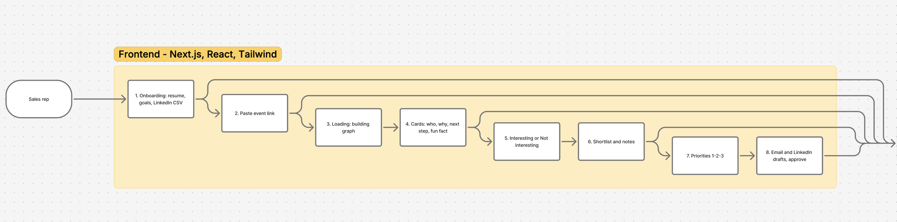
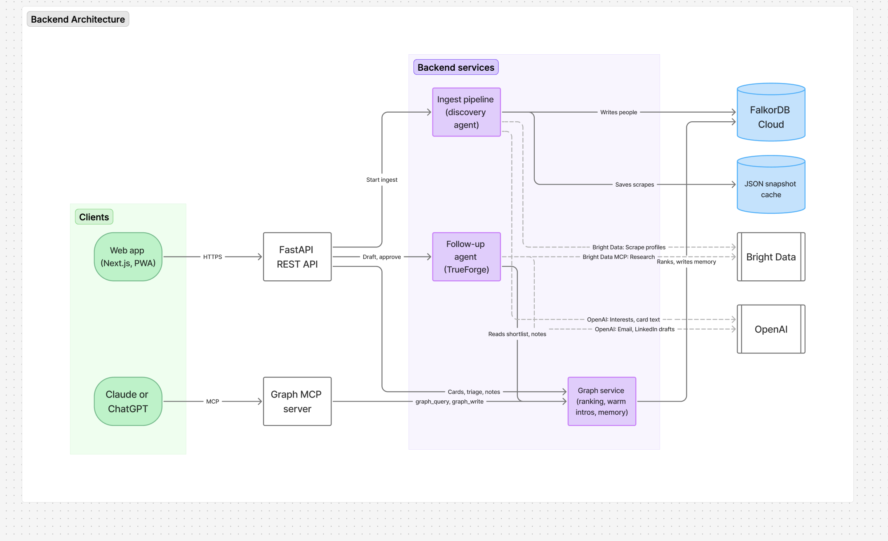

# Kairos

**Meet the right people. Follow up with purpose.**

**Live demo: https://kairos.spwt.app** (open it on your phone)

## What is Kairos?

Kairos is a networking companion for job seekers at conferences and tech events. You tell it what kind of role you want, paste a link to an event, and it shows you who is worth meeting there and why. After you talk to someone, you capture a quick note (typed or spoken), and Kairos helps you write a follow-up, an introduction, or a careful referral request grounded in what was actually said.

It remembers. Meet someone from OpenAI at one event, and when a colleague of theirs shows up at the next one, Kairos reminds you of that earlier conversation.

## The problem

Events are one of the best ways to find your next job, and one of the most wasted.

- **You walk in blind.** A speaker page lists 60 names. You have no idea which five matter for the role you want.
- **Conversations evaporate.** By the evening you remember a face, not what you talked about or what you promised to send.
- **Follow-ups come out generic.** "Great to meet you!" gets ignored. A message that mentions your actual conversation gets a reply.
- **Context is scattered.** The people you met last month, the colleague you talked to at another event, the job you're targeting: none of it connects.

Kairos turns one event link into a ranked, explained shortlist, keeps a memory of every conversation, and turns that memory into messages worth sending.

## How it works

### App flow



Onboard with your goals → paste an event link → Kairos builds the graph → swipe through ranked people → shortlist and take notes → see your top priorities → review AI-drafted emails and LinkedIn messages → approve and copy, or open them straight in Gmail. Kairos never sends anything on your behalf.

### System architecture



> These diagrams were our design plan. What runs today: the Next.js web app talks to a FastAPI backend, which ingests events through Bright Data, ranks people and stores memory in FalkorDB, and drafts messages with OpenAI. The TrueForge agent, the Graph MCP server and FalkorDB Cloud are on the roadmap. FalkorDB currently runs alongside the app, and drafting calls OpenAI directly.

## Tech stack

| Layer | Technology |
| --- | --- |
| Frontend | Next.js 16, React 19, Tailwind CSS (mobile-first web app) |
| Backend | Python 3.11+, FastAPI, Pydantic |
| Graph database | FalkorDB (Cypher) |
| Live web data | Bright Data Web Unlocker |
| AI | OpenAI (event extraction, message drafting, speech-to-text) |
| Hosting | Spawnpoint (one container: frontend + API + FalkorDB) |
| Tooling | uv, pytest, Ruff, GitHub Actions |

## Sponsor tools and how we used them

**FalkorDB: the memory and the matchmaker.**
Everything Kairos knows lives in a graph: you, your goals, the topics you care about, every person at every event, the companies they work at, and every note and message you've written. Ranking is a real multi-hop Cypher query (you → your goals → topics ← a person → the event), so every "why you should meet them" is a path you can see. The same graph powers cross-event memory: `Person → WORKS_AT → Company ← WORKS_AT → Person` is how Kairos knows that the OpenAI judge you're about to meet works with someone you talked to last week.

**Bright Data: the eyes on the web.**
Event pages are messy, JavaScript-heavy and often protected. Bright Data's Web Unlocker fetches any public event page reliably: Luma, conference speaker pages, hackathon sites. When the main page lists its judges or speakers on a separate tab, Kairos follows that link too. Every person keeps a link to the page they came from, and each fetch is saved as a snapshot, so the app still works if a site goes down mid-demo.

**OpenAI: the writer and the listener.**
OpenAI reads unfamiliar event pages and pulls out who is speaking, judging or attending. Every name must appear word-for-word on the page, so the model can't invent anyone. It drafts your follow-ups using only real facts: your profile, the person, your notes, and memories from the graph. It never invents a conversation or claims someone can refer you. And it turns the voice notes you record in a hallway into text you can edit.

## Run it locally

You need Python 3.11+, [uv](https://docs.astral.sh/uv/), Node.js 20+, and Docker (for FalkorDB).

**1. Configure keys.** Copy `.env.example` to `.env` and fill in:

```sh
KAIROS_BRIGHTDATA_API_KEY=...   # Bright Data Web Unlocker
KAIROS_BRIGHTDATA_ZONE=...      # your Web Unlocker zone name
KAIROS_OPENAI_API_KEY=...       # drafting, extraction, voice notes
```

The Bright Data key is needed to load real events. Without the OpenAI key, drafts fall back to clearly labeled templates, and only Luma pages can be read.

**2. Start FalkorDB.**

```sh
docker compose up -d graph
```

**3. Start the backend** (API docs at http://127.0.0.1:8000/docs).

```sh
uv sync
KAIROS_STORAGE=falkordb uv run uvicorn kairos.app:app --app-dir backend --port 8000
```

**4. Start the frontend** and open http://localhost:3000.

```sh
cd frontend
npm ci
npm run dev
```

**Run the tests.**

```sh
uv run pytest -q                                          # SQLite
TEST_FALKORDB_URL=redis://localhost:6379 uv run pytest -q # plus real FalkorDB
```

Want to watch what the backend is doing? `uv run python backend/watch_logs.py` streams every fetch, extraction, ranking and draft in real time.

## Future work

Kairos is built for job seekers, but the core idea (know who's in the room, remember what was said, follow up with substance) fits anywhere relationships matter:

- **Sales and business development:** rank attendees by fit with your product, remember every prospect conversation across trade shows, and draft follow-ups that reference what the buyer actually said.
- **Founders and fundraising:** find the investors at a demo day who fund your stage and space, and keep a memory of every pitch conversation.
- **Recruiters:** flip it around and find the candidates at a hackathon who match an open role.
- **Researchers and students:** find the speakers working on your topic at an academic conference and keep track of who to email about what.

Next on the roadmap:
- Accounts, so each person has private data.
- The TrueForge follow-up agent.
- A Graph MCP server, so Claude or ChatGPT can query your networking memory directly.
- LinkedIn import to surface warm introductions.
