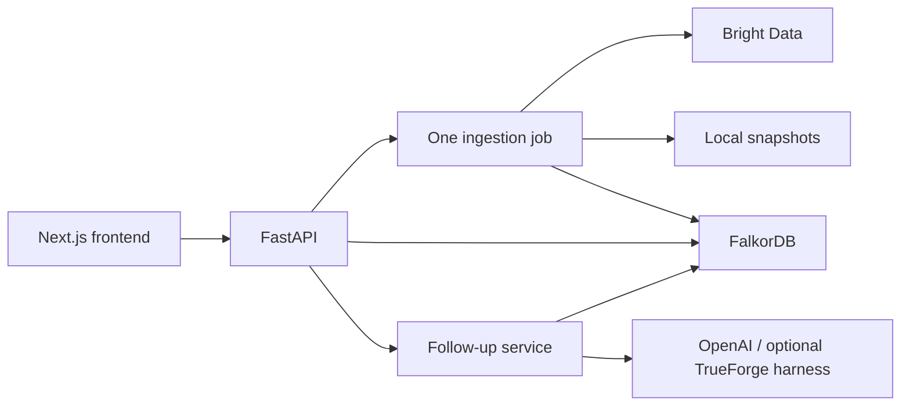

# Kairos — simplest v1

## Product decision

One user, one conference, 5–15 relevant people, one complete loop. The demo user sells a CI/CD product. Success means they can select someone for a sourced reason, save a conversation note, and create an editable follow-up grounded in that note.

The attached architecture is a longer-term direction. This plan intentionally reduces it to fit the hackathon. The original guide's suggested services, deadlines, and app installations are reference material, not evidence that anything has been configured.

## Essential flow

1. Enter name, product, goal, and 2–3 topic tags. No account signup or resume upload.
2. Paste the supported event URL. Clearly explain that v1 supports this event; arbitrary URLs are not promised.
3. Ingest public speaker/judge profiles from one selected event source via Bright Data. Show stage, count, source, and original collection time.
4. Show ranked cards: who, why, next step, and source links. Render the actual matching path. Missing facts remain absent.
5. Mark Interesting / Not interesting. Interesting people appear in a shortlist; skipped people leave discovery. Decisions are reversible.
6. Add multiple meeting notes. Preserve every note across reloads.
7. Draft an email and LinkedIn message for one shortlisted person. Edit and approve for copying; no message delivery integration.

Four UI views suffice: setup, discover, shortlist/person details, draft review. Mobile support uses the same responsive screens.

## Scope decisions

| Essential | After core passes | Defer |
| --- | --- | --- |
| Goal + product + topic tags | TrueForge follow-up tools and approval | Resume parsing, LinkedIn CSV |
| One Bright Data source | Top-three priorities using existing score | Universal event crawler |
| FalkorDB topic paths and memory | One evidence-backed warm-intro example | Reachability predictions |
| Cards, shortlist, append-only notes | Sourced professional opener | Funding/hiring enrichment |
| Editable grounded drafts | Additional real event source | External graph MCP, voice, transcripts |
| Honest snapshot fallback | Graph expansion view | Accounts, email sending, PWA/offline sync |

Keep optional contract fields for the future, but use null or empty arrays until supported. Same-company employment is a possible introduction route, not proof two people know each other. Do not label it a confirmed warm intro.

## Architecture

One backend process and a small in-process background ingestion task are sufficient for the demo. Persist job status and mark interrupted jobs failed on startup; no queue infrastructure yet. Bound ingestion size, timeout requests, retry once, and deduplicate people by stable source identity. Validate the supported host before any outbound fetch; reject private/local addresses and unapproved redirects.

FalkorDB stores users, goals, topics, people, conferences, triage, notes, and drafts. JSON snapshots preserve raw source data and provenance. Cache mode loads a real saved snapshot into the graph; it must not silently substitute fictional fixtures. Without a real snapshot, show an explicit missing-data state or a separately labeled fixture mode.

## Graph work that matters

Use explicit paths first:

- User → HAS_GOAL → Goal → TARGETS → Topic ← INTERESTED_IN ← Person.
- Person → APPEARS_AT → Conference scopes discovery.
- User → TRIAGED → Person records the decision in conference context.
- User → WROTE → Note → ABOUT → Person preserves individual notes and timestamps.
- User → OWNS → Draft → FOR → Person stores edited content and approval state.

Rank only people in the selected conference. Start with distinct matched-topic count, normalized by the user's selected-topic count. Sort ties by stable person ID. Exclude not_interesting from default discovery, while allowing explicit filters to recover them. Return the exact matching graph edges as the explanation, rather than generating a plausible-looking path. Test talk-based paths separately if added; the guide's proposed variable-length query should not be copied unverified.

## Build sequence and owners

Use elapsed build time because the guide's early checkpoints may already have passed. Preserve the team's 3:30 PM scope check, 4:15 PM freeze, and 5:30 PM demo target, all Pacific, if still feasible.

| Slice | Approximate budget | Owner | Exit criterion |
| --- | --- | --- | --- |
| 0. Contract and fixtures | 20 min | Kiran + Michelle | Agree enums/nullability; frontend renders all five fixtures |
| 1. Persistent core | 60 min | Kiran | Graph seed, ranked cards, triage, notes survive API restart |
| 2. Real data | 60 min | Kiran | One Bright Data source returns verified people; snapshots reload |
| 3. UI connection | 45 min | Michelle + Kiran | Goal → cards → shortlist → note works end to end |
| 4. Grounded drafts | 45 min | Kiran | Saved note appears accurately in editable draft; approve persists |
| 5. Hardening and pitch | Remaining time | Team; Chloe leads pitch | Live run, cached run, source inspection, concise demo |

Michelle can develop UI against fixtures while backend work proceeds. This is team ownership, not an instruction to spawn automated agents.

Small proposed PRs: contract/fixtures, graph persistence/ranking, ingestion/cache, frontend wiring, follow-up drafting, demo fixes. Qodo app installation and branch protection are pending repository settings; confirm a usable review path before requiring checks that do not exist.

## Sponsor priorities

Bright Data and FalkorDB are the core story. Demonstrate a real supported source and real multi-hop ranking plus persistent note memory. Add TrueForge only after the basic flow is stable; direct OpenAI use does not qualify as a TrueForge integration. Qodo requires real reviewed PRs and genuine fixes. A normal app note writer is not an AI agent; do not describe it as a third agent.

## Acceptance checks

- Changing topic tags changes rankings and all displayed why-edges exist in the stored graph.
- Conference A cannot return Conference B's candidates; unknown IDs return 404.
- Triage changes both discovery and shortlist, and can be undone.
- Two added notes remain in order after restart, with their original timestamps.
- Source failure uses only the last successful snapshot, marks it stale, and preserves its timestamp. No snapshot yields a visible error.
- Draft generation references supplied notes and source facts without inventing meetings, interests, or mutual contacts.
- Edited approval saves the exact subject, email body, and LinkedIn message. Subsequent edits require approval again. Nothing sends.
- Fixture mode is visibly labeled. Live sponsor claims are made only after live verification.

## Demo in 90 seconds

Enter a CI/CD sales goal. Show three relevant people and expand one why-path. Open its source. Shortlist a person, record a meeting note, and generate a follow-up that uses that note. Edit and approve. Reload to show memory. If live ingestion fails, show the labeled cached snapshot and its original timestamp.

## Inputs still needed for live implementation

The exact public event/judges URL; FalkorDB connection details; Bright Data and OpenAI credentials supplied through local environment configuration; a confirmed TrueForge setup if pursuing that track. Never put credentials in project documents or commits. The Figma screenshots and two provided text guides informed this plan; the live Figma board has not been fetched.
